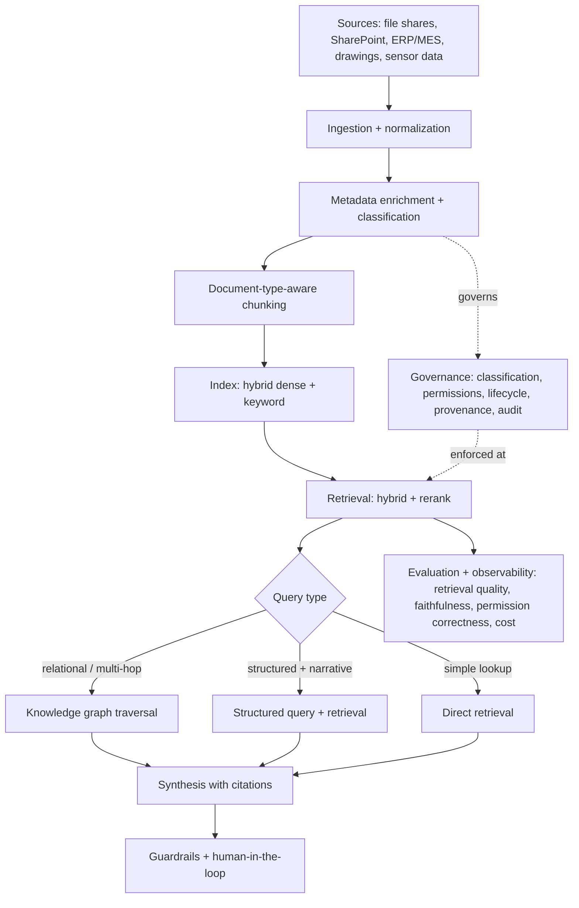
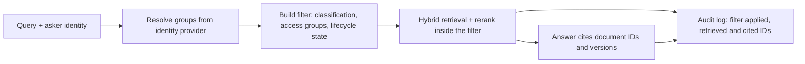

# Enterprise Knowledge Architecture Playbook

A repeatable method for turning decades of unstructured organizational knowledge into an AI-ready knowledge base, and for designing the system that serves it. Written for the work that should happen *before* a line of pipeline is built: assessment, information architecture, governance, platform choice, and roadmap.

This is the realized form of the `groundwork` spec. The companion `worked-example.md` applies the whole method to a fictional manufacturer.

---

## The one thing to internalize first

Enterprise RAG projects rarely fail on the model. They fail on information architecture and governance: documents are stale or duplicated, access control never reaches the retrieval layer, chunks lose their table and section context, metadata is missing or inconsistent, and evaluation only ever tests the questions that were always going to work. The managed platforms (Bedrock Knowledge Bases, Azure AI Search, Vertex) all retrieve whatever they are handed. None of them decide what is authoritative, who may see it, or whether it is still true.

So the work that moves the needle is upstream of retrieval. This playbook spends most of its effort there on purpose.

---

## Phase 0 — Assessment (before designing anything)

Audit what exists before recommending a system. Five inventories:

1. **Knowledge-source inventory.** Every place knowledge lives: file shares, SharePoint, ERP/MES, email, drawings, tribal knowledge in people's heads. For each: owner, format, volume, sensitivity, update frequency, and whether it is the source of truth.
2. **Data-source inventory.** Structured systems and, increasingly, machine and sensor data: schemas, refresh cadence, access path.
3. **Process maps.** How work actually flows through each department, so retrieval can be organized around real processes rather than folder structures.
4. **Use-case capture.** The questions people actually need answered, grouped by who asks and how often. This is what readiness gets measured against.
5. **Readiness pass.** Run a goal-driven readiness scan (the `litmus` tool) per intended use case, producing a per-document and corpus-level verdict and a remediation backlog.

Output of Phase 0: a current-state map and a prioritized remediation list, not an architecture diagram. Resist the urge to design before this is done.

---

## Information architecture

The retrievable unit of an enterprise is not "a document," it is "a thing the business cares about, described by documents." Design that model explicitly.

- **Taxonomy and ontology.** Name the entities (departments, processes, equipment, products, materials, failure modes, procedures) and the relationships between them. This is what lets retrieval answer "what procedures touch this machine" rather than only "find documents similar to this query."
- **Metadata schema.** A required core set on every document: title, document type, owning department, author, created and last-reviewed dates, version, source-of-truth flag, sensitivity/classification, and the entities it describes (equipment, process, product). Optional fields per type.
- **Document standards.** A "good document" definition: a clear title, headings, tables kept as tables, no uncontrolled duplicate copies, and the metadata above. Provide a template and a controlled vocabulary so new knowledge enters clean.
- **Source-of-truth model.** For every topic, one authoritative document, with everything else marked as derived or superseded. Conflicting "truths" are the fastest way to lose user trust.

---

## Reference AI architecture

A technology-agnostic blueprint. Each stage is a place to make a deliberate decision, not a fixed product.

The two stages teams skip, and must not: **governance enforced at retrieval time** (not just at ingest, because permissions and document validity change after indexing), and **evaluation that measures retrieval quality separately from answer quality**, including permission correctness and cost per query, not just happy-path answers.

---

## Governance model

The reference architecture shows governance as a side box that governs enrichment and is enforced at retrieval. This section fills in that box. It covers five controls: classification, permissions, lifecycle, provenance and audit. For each one, agree with the client what it means for them, which metadata fields carry it, and where it is checked.

Most of these controls have two halves: the fields are set at ingest and checked again on every query. The second half is needed because the facts behind the fields change after indexing. Documents are reclassified, people change teams, procedures are superseded and files are deleted. If the check only runs at ingest, the index keeps serving the old state until the next full re-index.

| Control | What to decide | Carried by | Checked at |
|---|---|---|---|
| Classification | the sensitivity levels, and who may assign each | `classification` | ingest (assigned), retrieval (filter) |
| Permissions | which roles and departments see which classifications, plus per-document exceptions from the source system | `owning_department`, `classification`, optional `access_groups` | retrieval, inside the search |
| Lifecycle | the review interval per document type, what happens when it lapses, how supersession and deletion reach the index | `last_reviewed_date`, `version`, `supersedes`, `source_of_truth` | ingest, a scheduled sync, retrieval |
| Provenance | what every chunk and every answer must trace back to | document ID, `version`, source location, ingestion time | ingest (stamped on chunks), answer (cited) |
| Audit | what each query logs, who may read the log, how long it is kept | the audit log | every query |

On every query, the retrieval-time checks run in this order:

**Classification.** Keep the scale short. Four levels (for example public, internal, confidential and restricted) are enough for most organisations. Derive the level at ingest from where the document lives when that location is already access-controlled, and send anything that cannot be classified to a review queue. Until someone reviews it, treat an unclassified document as the highest level.

**Permissions.** Four rules make permission-aware retrieval hold up in practice:

1. Apply the permission filter inside the search, so ranking only ever sees documents the asker may read. Filtering after retrieval causes two problems: the top results can all be removed, leaving a poor answer with no explanation, and counts, snippets or "access denied" notices can reveal that a restricted document exists.
2. Resolve the asker's groups from the identity provider at query time. A copy taken at ingest goes out of date as soon as someone moves team.
3. Deny by default. A document whose access metadata is missing or unreadable is excluded until it is fixed.
4. Agree with the client's security team how quickly a revoked permission must take effect in the knowledge base, then set the access-sync schedule to meet that figure.

Managed platforms differ in how much of this they handle. Most offer metadata filters at query time. Find out whether the platform also syncs access lists from the source systems, or whether keeping `access_groups` current is left to you.

**Lifecycle.**

- Set a review interval per document type (for example 12 months for procedures and 24 for reference material). When `last_reviewed_date` passes it, notify the owner, and decide whether overdue documents are flagged in answers, ranked lower or excluded.
- When a new version is published with `supersedes` set, remove the old version from the default index on the same sync. Keep superseded versions searchable only for people who need the history, such as quality auditors.
- Deleting a document at source must remove its chunks and embeddings from the index. Retention rules and legal holds apply to the index and the audit log in the same way they apply to the source.

**Provenance.** Stamp every chunk with its document ID, version, source location and ingestion time, and have every answer cite the documents and versions it used. Users can then check the source, reviewers can trace a wrong answer back to the chunk that caused it, and the system can re-check permissions and lifecycle against those IDs before the answer is shown.

**Audit.** For each query, log who asked and when, the query text (subject to the client's privacy rules), the filter that was applied (the asker's resolved groups and the lifecycle constraints), the IDs of the chunks retrieved and the IDs cited in the answer. Log IDs rather than content, so the audit log does not become a second copy of restricted material. Decide who may read the log and how long it is kept.

**Ownership.** Each control needs a named owner on the client side. One workable split: document owners keep metadata and review dates current; a knowledge-management lead or data steward owns the classification scheme and the review queue; the security team owns the access model and the revocation target; the platform team owns the sync jobs and the audit log. Record it as a RACI before the pilot starts.

**Testing.** Test governance with a fixed test set, in the same way as retrieval quality. For permissions, create test users with known scopes and write queries whose best answers sit in documents some of those users may not see. The test passes only if no answer uses a document its asker cannot read. For lifecycle, write queries where a superseded version is the closest match; the answer must come from the current version or say that nothing was found. Run both suites on every change to the index, the sync jobs or the access model.

**Outputs of this step:** the classification scheme, an access matrix (roles by department by classification), a lifecycle policy per document type, the provenance fields, an audit-log specification, the ownership RACI and the governance test set.

---

## Platform and technology selection

A decision framework, not a single answer.

- **Anchor on the cloud the organization already runs.** The authentication, networking, and compliance integration of staying on one cloud outweighs model or feature differences. AWS shop, lean Bedrock Knowledge Bases; Microsoft 365 and Azure shop, lean Azure AI Search plus Azure OpenAI.
- **Managed vs assembled.** Managed RAG (Bedrock Knowledge Bases, Azure AI Search) removes most of the pipeline and the need to operate a vector store; the trade is flexibility and some lock-in. Assemble your own (a vector store such as Qdrant or Weaviate, an orchestration layer, a reranker, RAGAS) only when a real requirement demands the control. Most teams should start managed.
- **IP-sensitive or air-gapped.** For an organization that will not let its proprietary knowledge leave its boundary, prefer private-network deployment, and keep a self-hostable option (such as Onyx) on the table. Make this an explicit requirement early, because it constrains everything downstream.
- **Cost realities.** Watch the standing costs (a managed vector store can carry a monthly baseline even at zero traffic; newer low-cost vector storage options change that math), the long-context billing cliff (retrieving too much context per query is the silent cost driver), and prompt/context caching, which materially cuts repeat-query cost.

The output is a recommendation with reasons, plus the two or three alternatives and why they were not chosen. That reasoning is the deliverable, more than the pick itself.

---

## Metadata and document standards (concrete)

Recommended core metadata, every document:

| Field | Why it matters |
|---|---|
| title, type | retrieval filtering and display |
| owning_department | scope and access |
| author, created_date, last_reviewed_date | freshness and trust |
| version, supersedes | lifecycle and conflict resolution |
| source_of_truth (bool) | authority |
| classification | governance and permission trimming |
| entities (equipment / process / product) | the ontology link that powers relational retrieval |

The "good document" standard: real title, headings, tables preserved as tables, one controlled copy, complete core metadata. Provide a one-page template and put it where new documents are created, so the corpus improves at the source rather than only in cleanup.

---

## Historical and future (sensor) data

- **Historical documents.** Triage by the readiness scan: OCR the scanned set, deduplicate, designate source-of-truth, backfill the minimum viable metadata. Do not try to perfect everything; prioritize by use-case value.
- **Future machine and sensor data.** Plan for it as a first-class, separate modality: time-series and telemetry stored and queried differently from documents, joined at answer time (structured query for the number, retrieval for the narrative). Designing the metadata and entity model now so a machine reading links to the equipment it came from is what makes the future integration cheap rather than a re-platform.

---

## Roadmap and maturity model

Crawl, walk, run. Each phase ships value and de-risks the next.

- **Crawl (foundation).** Phase 0 assessment, information architecture and standards agreed, governance model defined, readiness remediation begun, one high-value use case piloted on a managed stack with evaluation in place.
- **Walk (expand).** Broaden sources, enforce permission-aware retrieval, add the relational (graph) and structured-data paths where use cases need them, stand up observability and a feedback loop.
- **Run (operate).** Continuous ingestion and freshness, online evaluation and drift monitoring, cost governance, and a maintenance model the internal team owns.

A maturity model the client can self-assess against (sources mapped, metadata coverage, permission correctness, evaluation coverage, freshness) makes the roadmap a conversation rather than a wall of tasks.

---

## Mistakes to avoid

- Building before assessing. The assessment is the cheapest risk reduction available.
- Treating access control as a frontend concern. If permissions do not propagate into retrieval, the system will answer using documents the asker was never allowed to see.
- Letting chunking destroy structure. Tables and sections carry the meaning in technical documents.
- Happy-path evaluation. Measure retrieval quality, faithfulness, permission correctness, latency, and cost per query, not just whether the demo question works.
- Over-retrieval. Pulling too much context per query is the silent driver of both cost and degraded answers.
- Big-bang rollout. The pilot-failure rate on enterprise GenAI is high; phased delivery against one high-value use case beats a platform-wide launch.
- No source of truth. Conflicting authoritative documents erode trust faster than any model error.

---

## How to use this playbook

1. Run Phase 0 and produce the current-state map and remediation backlog.
2. Agree the information architecture, metadata schema, and document standard.
3. Define the governance model (classification, permissions, lifecycle, provenance, audit), following the Governance model section above.
4. Select the platform with the decision framework and document the reasoning.
5. Pick one high-value use case, build it on the chosen stack with evaluation, and use it to validate the architecture before expanding.

See `worked-example.md` for the whole method applied end to end.
